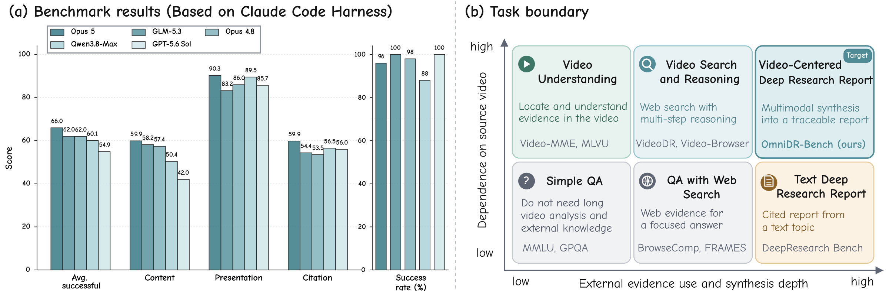
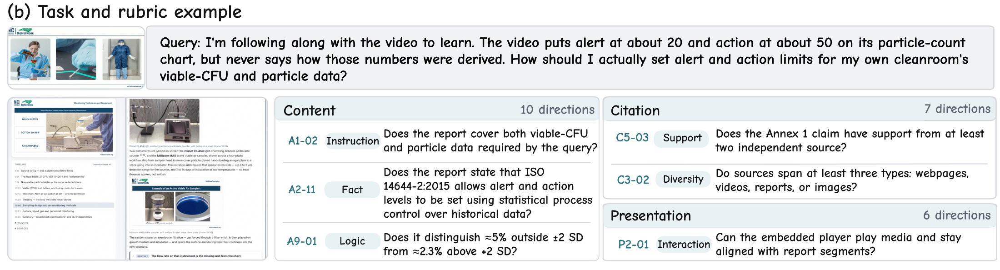
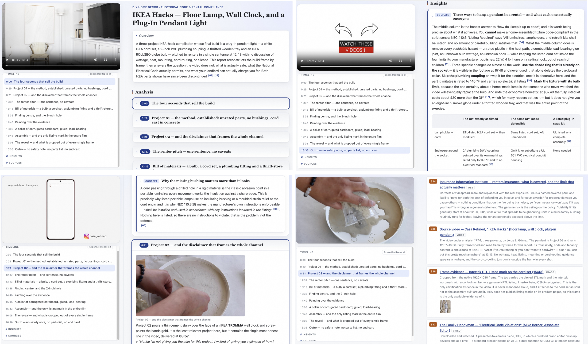
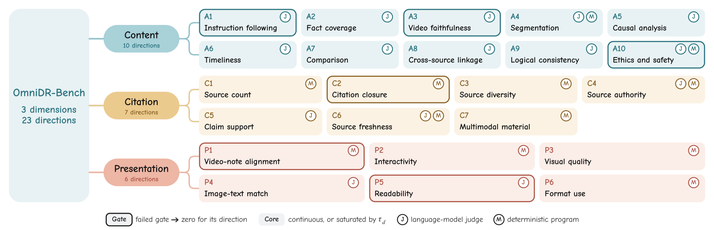
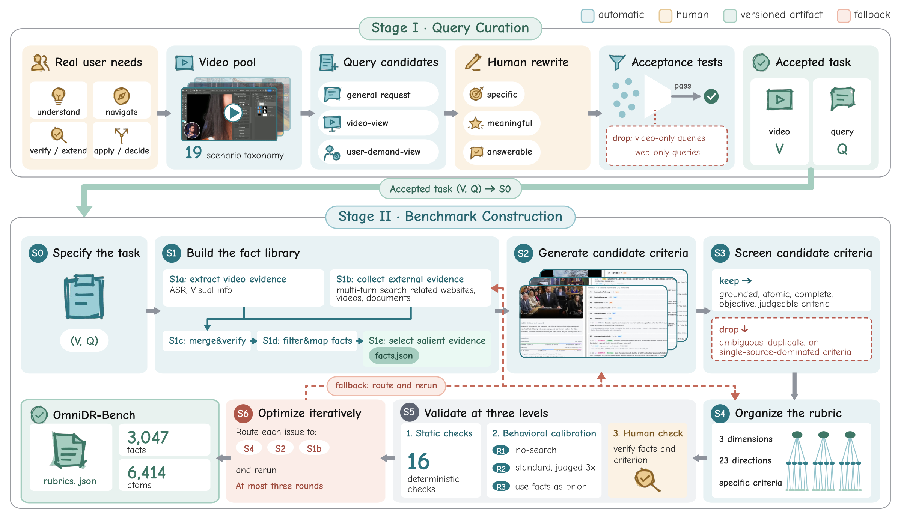
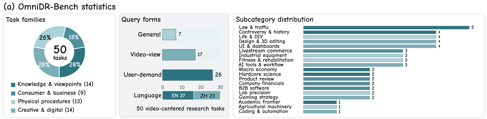
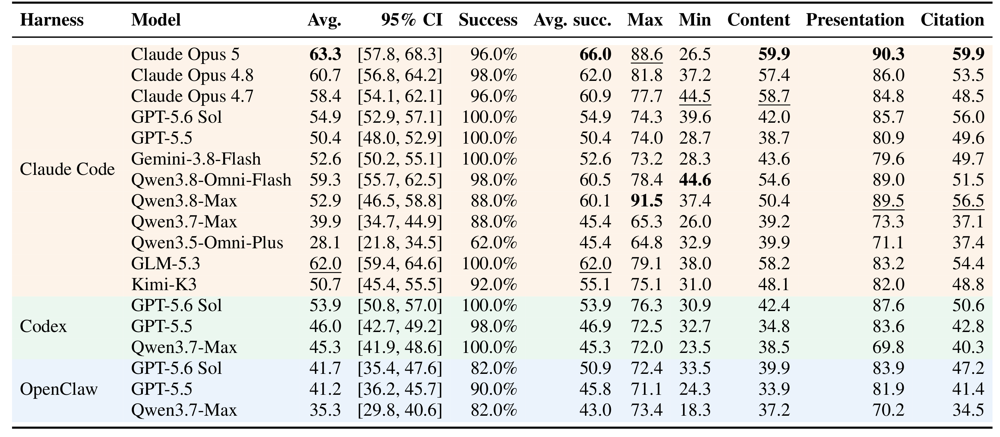

# Beyond Watching and Searching: Benchmarking Agents for Video-Centered Deep Research Reports

**OmniDR-Bench** benchmarks **Video-Centered Deep Research Report Generation**: given a source video and a user request, an agent produces an interactive, citation-traceable HTML report that keeps the video at the center. **50 bilingual tasks**, **6,414 binary rubric criteria**.

[Paper](https://arxiv.org/abs/2610.xxxxx) · [Dataset](https://huggingface.co/datasets/marinero4972/OmniDR-Bench) · [Data Usage Notice](https://huggingface.co/datasets/marinero4972/OmniDR-Bench) · [Report Format](REPORT_FORMAT.md) · [Quick Start](#quick-start) · [Results](#results) · [Citation](#citation)



## The Task: Video-Centered Deep Research

Videos carry knowledge text cannot: on-screen charts, demonstrated procedures, spoken claims, and their timing. Viewers need more than a recap: they want to **locate moments**, **verify claims**, **reproduce procedures**, or **make decisions**. OmniDR-Bench makes this a task:

> **Input.** Source video `V` + user request `Q`.
> **Output.** An interactive HTML report grounding findings in the video's audiovisual evidence, enriched with external multimodal research, linking each claim to a citation and a video timestamp.

A task is accepted only when neither video-only analysis nor generic web search suffices alone. Below, one accepted task: the request cannot be answered from the video, and the sample criteria show what a good report must establish.



## What a Generated Report Looks Like

The output is a self-contained interactive report, not a short answer. The example (pendant-light safety task) shows an audiovisual timeline aligned to the video, findings citing external evidence, embedded media, and claim-level citations resolving to full sources. Each note jumps to its video time and each claim to its source.



## Evaluation: Omni Atomic Rubric Trees

Open-ended reports have no reference answer, so every report is scored by an **Omni Atomic Rubric Tree (Omni-ART)**: 3 dimensions → 23 shared directions → task-specific binary leaves. Upper levels stay comparable across tasks while leaves test what each task's evidence demands.



Each leaf is yes/no, judged by a multimodal model (**J**) or a deterministic program / browser probe (**M**). Outlined directions are **gates** (a failed gate zeroes its direction); the three high-volume directions saturate credit so they cannot dominate.

## Benchmark Construction & Statistics

Each tree is built by **Audited Rubric Construction (ARC)**: isolated audiovisual and open-web evidence collection, criteria derived from that independent fact library, then static checks, behavioral calibration, and human review. Evaluated reports never enter construction.





50 tasks across four families and 19 subcategories, 27 English / 23 Chinese, referencing 42 source videos; 3,102 verified facts and 6,414 criteria (~128 per task).

## Results



Table 3 compares 18 model-harness configurations. **Avg.** covers all 50 tasks (zero for unsuccessful reports); **Avg. succ.** and dimension columns cover scored reports. The best system reaches 63.3 overall. Presentation far exceeds content and citation, so current agents meet layout needs more reliably than coverage, reasoning, and citation support.

## Quick Start

### 1. Install

Requires **Python 3.10+**, **Node.js 18+**, and an OpenAI-compatible Chat Completions endpoint with text and vision judging. Evaluation runs on CPU.

```bash
python3 -m venv .venv
source .venv/bin/activate
python -m pip install -r requirements.txt
python -m playwright install --with-deps chromium
```

### 2. Prepare videos and reports

Get `OmniDR-Bench.jsonl` from [Hugging Face](https://huggingface.co/datasets/marinero4972/OmniDR-Bench) and store it outside this repository:

```text
OmniDR-Bench-data/
├── OmniDR-Bench.jsonl
└── videos/
    └── {id}.mp4              # supplied by the user
```

`OmniDR-Bench.jsonl` has **50 lines**, one task per line:

| Field | Contents |
|---|---|
| `id` | Unique task ID. |
| `video_url` | Public YouTube or Bilibili source-page URL. |
| `query` | User request in its original language. |
| `rubric` | Complete evaluation criteria and scoring configuration. |

See the [bilingual dataset usage notice](https://huggingface.co/datasets/marinero4972/OmniDR-Bench) before using the data.

**Videos and audio are not distributed.** Obtain source videos independently under the applicable terms and place them at `videos/{id}.mp4` (e.g. `OmniDR-Bench-data/videos/OmniDR-Bench-v0-0001.mp4`). This repository provides no download tools.

The reference report harness will be integrated into Qwen-MM-Plugins.

Give the video and query to the evaluated system; reserve the rubric for scoring. Place each complete report under its model and task ID:

```text
reports/
└── my_model/
    └── OmniDR-Bench-v0-0001/
        ├── index.html
        ├── js/data.js
        └── ...              # all referenced scripts, styles, images, and media
```

A `report/` wrapper inside the task folder is also accepted. Reports must include their referenced local resources with working relative paths; see [Report Format](REPORT_FORMAT.md). No generated reports or evaluation outputs are bundled.

### 3. Configure judges

```bash
cp .env.example .env
```

Set `OPENAI_BASE_URL` (the prefix before `/chat/completions`, usually ending in `/v1`) and `OPENAI_API_KEY`. No endpoint or credentials are included.

`OMNIDR_JUDGE_MODEL` selects the judge (default `gpt-5.6-sol`, as in the paper) for both text and vision; recency checks use today's date. Override with `--vision-model` or `--evaluation-date YYYY-MM-DD`; environment variables override `.env`.

### 4. Evaluate

Run from the repository root:

```bash
# Validate report structure without API calls or browser rendering.
python evaluate.py --reports-dir ./reports --data-dir /path/to/OmniDR-Bench-data --validate-only

# Evaluate all submitted model folders on all 50 tasks.
python evaluate.py --reports-dir ./reports --data-dir /path/to/OmniDR-Bench-data

# Evaluate one model and one task.
python evaluate.py --reports-dir ./reports --data-dir /path/to/OmniDR-Bench-data \
  --models my_model --instances OmniDR-Bench-v0-0001
```

`--data-dir` must point to the directory containing `OmniDR-Bench.jsonl`; it is not bundled here. Use `--jobs` / `--workers` for concurrency (defaults 1 / 4). `--no-llm` skips judge calls and `--skip-render` skips browser checks; both yield **partial scores**. See `python evaluate.py --help`.

Re-running resumes compatible cached judgments; changes to a task, report, judge settings, or date invalidate the cache (`--force` to re-evaluate). Outputs go to `results/` (`--output-dir`):

- `summary.json`: model statistics and per-task status.
- `scores.csv`: task totals and dimension scores.
- `{model}/{id}.json`: detailed rubric judgments and scores.
- `.cache/`: per-task inputs, browser measurements, and resume metadata.

The primary metric is `by_model[model].total_score.mean` in `summary.json`, averaging **all selected tasks** with zero for missing or unreadable reports. Check `evaluation_complete`, `n_errored`, and `n_unresolved` before reporting. Exit codes: `0` complete, `1` incomplete, `2` input/config error; partial modes stay labeled partial.

## License

Evaluation code: [MIT](LICENSE). Dataset texts and arrangement: [CC BY-NC 4.0](https://creativecommons.org/licenses/by-nc/4.0/legalcode.en), per the [bilingual data usage notice](https://huggingface.co/datasets/marinero4972/OmniDR-Bench). Neither extends to source videos, audio, or other third-party materials.

## Citation

```bibtex
@article{meng2026omnidr,
  title={Beyond Watching and Searching: Benchmarking Agents for Video-Centered Deep Research Reports},
  author={Meng, Jiahao and Yang, Qize and Wang, Yuxuan and Chu, Yunfei and Dai, Wensi and Xu, Jin and Tong, Yunhai},
  journal={arXiv preprint arXiv:2610.xxxxx},
  year={2026}
}
```
